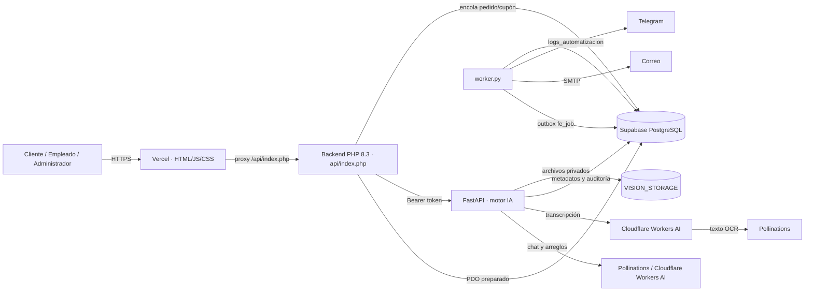

# Portada

**Proyecto:** Flora Elegante — comercio electrónico de arreglos florales con gestión de pedidos, automatizaciones y visión por computador.

**Curso / asignatura:** _[Completar]_

**Docente:** _[Completar]_

**Integrantes:** _[Completar nombres y códigos]_

**Fecha de entrega:** noviembre de 2026

**Repositorio:** _[Completar enlace]_

**URL desplegada:** `PENDIENTE` (reemplazar por la URL de Vercel al publicar)

\newpage

# 1. Introducción y objetivo

Flora Elegante es una aplicación web para una florería que vende arreglos florales, programa entregas, administra inventario y atiende clientes con un chatbot. En esta entrega final se consolidan cuatro frentes:

1. Documentación técnica y operativa reproducible.
2. Despliegue del frontend en Vercel y del backend en un servidor con Docker Compose.
3. Un módulo de empleado con visión por computador y confirmación humana.
4. Automatizaciones propias y medidas de seguridad para datos personales.

El sistema sustituyó la dependencia de n8n por un **outbox transaccional** en PostgreSQL/Supabase y un **worker** en Python. Esto reduce puntos de falla, deja trazabilidad en `logs_automatizacion` y permite reintentos controlados sin bloquear la compra.

# 2. Arquitectura final



**Capas y responsabilidades**

| Capa | Tecnología | Responsabilidad |
|---|---|---|
| Presentación | Vercel + HTML + Tailwind + JS IIFE | Catálogo, carrito, chat, panel, módulo de empleado |
| API web | PHP 8.3, PDO | Autenticación, roles, validación, pedidos, CSRF |
| Datos | Supabase PostgreSQL 16 | Usuarios, productos, pedidos, outbox, auditoría, documentos |
| Motor IA | FastAPI + LangGraph | Chat, visión de arreglos, orquestación del OCR y validación de salidas |
| OCR de facturas | Cloudflare + Pollinations | Transcripción de imagen y estructuración del texto |
| Automatizaciones | `worker.py` | Envío SMTP/Telegram, reintentos, cierre mensual, cupones, logs |
| Despliegue | Vercel + Docker Compose/Caddy | Frontend estático y backend privado con HTTPS |

**Decisiones clave**

- El navegador nunca recibe `ENGINE_TOKEN` ni claves de proveedores: PHP actúa como proxy privado.
- Vercel no ejecuta PHP/Python; solo publica archivos estáticos y reenvía `/api/index.php` al backend HTTPS definido en `BACKEND_ORIGIN`.
- La IA **propone**; el código valida y la persona confirma. Ninguna salida del modelo se inserta como HTML.
- La compra solo escribe en Supabase PostgreSQL (pedido + outbox en la misma transacción). Los envíos ocurren después.
- Chat y arreglos usan `AI_PROVIDER` / `AI_FALLBACK` con `pollinations` y `cloudflare`. Pollinations responde el texto, Cloudflare analiza las fotos y sirve de respaldo. Si fallan, el flujo responde 503 y las reglas del chatbot siguen disponibles.

# 3. Inventario de flujos migrados (n8n → código propio)

| Disparador | Qué hacía en n8n | Cómo se programó en código propio | Manejo de errores y logs |
|---|---|---|---|
| Compra confirmada | Webhook HTTP enviaba el recibo | `fe_job` canal `pedido_email` + worker SMTP | 5 intentos con espera exponencial; `fe_audit` y `logs_automatizacion` |
| Compra confirmada | Webhook avisaba al equipo | `fe_job` canal `pedido_telegram` | Igual; no se registra el token del bot en logs |
| Revisión periódica (60 s) | Flujo programado de stock | `scheduled()` + estado `fe_state` | Deduplicación al reponer; alerta única por cruce |
| Aniversario de compra (7 días antes) | Nodo programado + correo | `core.anniversary()` + `fe_cupon` + outbox | Clave única por cliente y año; revocación desde preferencias |
| Día 1 de cada mes | Agregación mensual | `core.financial_summary()` + Telegram | No inventa utilidad si faltan costos históricos |
| Confirmación de visión | Nodo de alerta | `/vision/confirm` + outbox | Solo alerta tras confirmación humana |
| Revocación de marketing | Nodo condicional | `preferences.php` cancela jobs pendientes | Transacción + auditoría del consentimiento |
| Factura subida/confirmada por empleado | No existía | `fe_documento` + `fe_audit` | Estados `revisar`/`confirmado`; la IA no decide sola |

**Consecuencia:** `api/n8n.php` y las constantes `N8N_*` fueron eliminados. El panel administrativo (`automation-admin.js`) muestra jobs, reintentos manuales, costos y los últimos registros de `logs_automatizacion`. Los avisos salientes usan `TELEGRAM_BOT_TOKEN` y `TELEGRAM_CHAT_ID`; `scripts/check_telegram.py` valida el token con `getMe` y envía un mensaje de prueba antes de activar el worker.

# 4. Módulo de empleado y visión por computador

## 4.1 Caso de uso

El empleado recibe facturas, recibos o comprobantes de proveedores. El proceso es:

1. Captura una foto desde el celular o elige un archivo (JPG, PNG, WebP o PDF de una página, máximo 5 MB).
2. Oculta datos personales visibles y autoriza el tratamiento por proveedores externos.
3. Cloudflare Workers AI transcribe el texto y Pollinations propone proveedor, número, fecha, total, moneda y confianza de 0 a 1.
4. El servidor valida el JSON, persiste el OCR y muestra un formulario editable.
5. Solo al confirmar se guardan `datos_confirmados`, la fecha y el estado `confirmado`.

La confianza menor a 80 % se marca visualmente y exige revisión. La IA nunca modifica stock ni registra pagos por sí sola. Si Pollinations falla, se conserva el texto de Cloudflare y el documento queda en captura manual; la casilla de anonimización es una declaración humana, no una garantía técnica de redacción de datos personales.

**Canales de captura.** La factura se captura en la web de empleado, en escritorio o en celular mediante `<input type="file" accept="image/*,.pdf" capture="environment">`; el chatbot atiende el reconocimiento de arreglos florales con fotos, no la validación de facturas. Telegram se usa para alertas salientes; la recepción de facturas por Telegram es una extensión opcional no habilitada en esta entrega, por lo que no se le atribuyen resultados.

## 4.2 Protecciones técnicas

- Validación de rol `empleado` o `administrador` en PHP y, como defensa en profundidad, en el motor.
- Límite de una carga cada 10 segundos por sesión y tamaño máximo de 5 MB.
- Re-codificación de imágenes para eliminar EXIF/GPS; el PDF se rasteriza con PyMuPDF y se rechazan los documentos de varias páginas.
- Cloudflare recibe la imagen normalizada; Pollinations recibe solo el texto extraído. No se registran claves ni cuerpos de respuesta.
- Archivos en carpeta privada (`VISION_STORAGE`), con acceso validado por token, identificador hexadecimal y propietario.
- Registro de auditoría `fe_audit` para subida, resultado, error y confirmación.
- Tabla `fe_documento` para estado, confianza, JSON propuesto y datos confirmados.

## 4.3 Esquema de datos nuevo

```sql
CREATE TABLE fe_documento (
  id CHAR(32) PRIMARY KEY,
  empleado_id BIGINT NOT NULL,
  creado DATETIME NOT NULL DEFAULT CURRENT_TIMESTAMP,
  archivo VARCHAR(120) NOT NULL,
  tipo VARCHAR(20) NOT NULL DEFAULT 'imagen',
  resultado LONGTEXT NULL,
  confianza DECIMAL(4,3) NULL,
  estado VARCHAR(20) NOT NULL DEFAULT 'procesando',
  datos_confirmados LONGTEXT NULL,
  confirmado_en DATETIME NULL,
  FOREIGN KEY (empleado_id) REFERENCES usuario(id)
);
```

`logs_automatizacion` registra `nombre_flujo`, `fecha_inicio`, `fecha_fin`, `datos_entrada` (sin datos personales), `estado` (`PENDIENTE`, `EXITO`, `ERROR`) y `resultado_o_error`.

# 5. Resultados de pruebas

## 5.1 Pruebas automáticas ejecutadas

Comando:

```powershell
.venv\Scripts\python -m unittest discover -s tests -v
```

Resultado real del 20 de noviembre de 2026: **38 pruebas ejecutadas, 38 correctas (0 fallos, 0 errores)**. El entorno virtual del equipo apuntaba a una instalación de Python retirada, por lo que se recreó un entorno limpio con Python 3.11 y `engine/requirements.txt` para esta verificación.

| Grupo | Casos | Resultado |
|---|---|---|
| Reglas de negocio (aniversarios, cierre, utilidad) | 6 | OK |
| Validación de visión (IDs, confianza, confirmación) | 3 | OK |
| Validación de facturas (fecha, total, moneda, baja confianza, campos ignorados) | 5 | OK |
| OCR y flujo de facturas (contratos HTTP, reintentos, PDF, consentimiento, propiedad y recuperación manual) | 15 | OK |
| Servicio (token privado, imagen inválida, EXIF, PDF, fallo de IA, cadena de proveedores) | 8 | OK |
| Worker (propagación de fallo de correo) | 1 | OK |

También se verificó la sintaxis de todos los controladores PHP con `php -l` y de todos los módulos JavaScript con `node --check` (resultados en la sección 5.3).

## 5.2 Evaluación con 20 imágenes reales (pendiente de completar)

Los scripts exigen al menos 20 archivos reales distintos. **Las cifras no se inventan: deben llenarse al ejecutarlos con las fotos y facturas del equipo.** Mientras no se ejecuten, la tabla queda marcada como pendiente.

### Arreglos florales (objeto detectado)

`engine/evaluate_vision.py` recibe un CSV `archivo,producto_esperado` (vacío si no hay coincidencia) y reporta aciertos por foto.

```powershell
.venv\Scripts\python engine\evaluate_vision.py ruta\manifiesto_arreglos.csv tests\results\vision_reporte.json
```

| Métrica | Valor |
|---|---|
| Fotos evaluadas | _Pendiente (mínimo 20)_ |
| Aciertos | _Pendiente_ |
| Porcentaje de aciertos | _Pendiente_ |
| Errores de procesamiento | _Pendiente_ |
| Fecha de ejecución | _Pendiente_ |

### Facturas de proveedor (precisión por campo)

`engine/evaluate_documentos.py` recibe un CSV `archivo,proveedor,numero_factura,fecha,total,moneda` (las columnas esperadas pueden dejarse vacías para no evaluarlas) y calcula el porcentaje de acierto de cada campo y de documentos completos.

```powershell
.venv\Scripts\python engine\evaluate_documentos.py ruta\manifiesto_facturas.csv tests\results\documentos_reporte.json
```

| Campo | Aciertos / evaluados | Porcentaje |
|---|---|---|
| Proveedor | _Pendiente_ | _Pendiente_ |
| Número de factura | _Pendiente_ | _Pendiente_ |
| Fecha | _Pendiente_ | _Pendiente_ |
| Total | _Pendiente_ | _Pendiente_ |
| Moneda | _Pendiente_ | _Pendiente_ |
| Documento completo | _Pendiente_ | _Pendiente_ |

Tabla de detalle sugerida (la generan los scripts):

| Archivo | Esperado | Obtenido | Confianza | ¿Acierto? |
|---|---|---|---|---|
| _foto_01.jpg_ | _valor_ | _valor_ | _0.00_ | _Sí/No_ |
| _…_ | | | | |

## 5.3 Verificación de sintaxis y pruebas manuales

| Verificación | Comando | Resultado |
|---|---|---|
| PHP | `php -l` sobre `api/*.php` | 21/21 sin errores de sintaxis |
| JavaScript | `node --check` sobre `js/*.js` | 17/17 sin errores de sintaxis |
| Login de los tres roles | Navegador | _Pendiente de ejecución manual_ |
| Carga JPG/PNG/WebP y PDF | `empleado.html` con motor activo | _Pendiente de ejecución manual_ |
| Confirmación y baja confianza | `empleado.html` | _Pendiente de ejecución manual_ |
| Reintento de job fallido | `admin.html` → automatizaciones | _Pendiente de ejecución manual_ |

Las pruebas automáticas cubren reglas puras, validación de salidas de IA, aislamiento del motor, eliminación de metadatos, conversión de PDF y respaldo de proveedor. Las pruebas de navegador requieren una base Supabase migrada y un proveedor de IA con credenciales.

# 6. Seguridad y protección de datos personales (Ley 1581 de 2012)

El diseño adopta los principios de la **Ley 1581 de 2012 (Colombia)** y, para la operación localizada en México, su equivalente **LFPDPPP**: finalidad, consentimiento, minimización, acceso restringido y trazabilidad.

## 6.1 Clasificación y tratamiento

| Dato | Clasificación | Finalidad | Medida aplicada |
|---|---|---|---|
| Nombre, correo | Público/semiprivado | Cuenta, recibo, contacto | Validación y acceso autenticado |
| Teléfono, dirección | Semiprivado | Entrega del pedido | Visible solo para operación; no en respuestas públicas |
| Fecha de nacimiento, preferencias | Privado | Personalización y cupones | Acceso autenticado; consentimiento de marketing |
| Identificación, método de pago | Sensible | Verificación y preferencia | Oculto al administrador; nunca en listados públicos |
| Contraseña | Sensible | Autenticación | Hash bcrypt; nunca texto plano |
| Imágenes de facturas | Privado de empresa | Verificación de compras | Carpeta privada, token, validación de propietario |
| Logs y auditoría | Interno | Seguridad y operación | Sin cuerpos de mensajes ni credenciales |

## 6.2 Controles implementados

- Autorización por rol en el backend (`require_auth`, rol `empleado`/`administrador`) y vistas protegidas en el frontend.
- CSRF central para todo POST, cookie `HttpOnly`, `SameSite=Lax` y `Secure` cuando hay TLS; `X-Forwarded-Proto` solo se acepta desde `TRUSTED_PROXIES`.
- Los controladores `api/*.php` no se ejecutan por URL directa: el rewrite de Apache solo permite `api/index.php`. Vercel devuelve 404 para cualquier otra ruta `/api/*`.
- Consultas preparadas, validación de tipos y límites de longitud; mensajes de error sin detalles internos.
- Límite de intentos de login (8 fallos por correo+IP en 15 minutos) y bitácora `intento_login`.
- Sesión regenerada tras login/registro para evitar fijación.
- Auditoría de consentimiento, pedidos, visión, documentos y automatizaciones.
- Borrado de metadatos EXIF/GPS, identificadores hexadecimales validados y acceso privado a archivos.
- Reintentos y logs sin tokens ni contraseñas; encabezados `nosniff`, `X-Frame-Options` y `Referrer-Policy` en Apache y Caddy.

## 6.3 Derechos y retención

El cliente puede actualizar sus datos, revocar el consentimiento de marketing y solicitar eliminación de imágenes. Se recomienda eliminar las facturas cuando termine la verificación y conservar solo los datos confirmados necesarios. Los logs operativos deben rotarse o depurarse según la política de la empresa.

**Limitaciones declaradas:** los campos sensibles no están cifrados a nivel de columna; se protegen por control de acceso y se recomienda cifrado de disco/base, rotación de credenciales y una política de retención. La anonimización del contenido visible de las facturas depende de la revisión humana: no hay redacción automática de datos personales antes de enviar el texto a Pollinations.

# 7. Limitaciones y plan B

| Riesgo | Impacto | Plan B |
|---|---|---|
| Cuota o caída de Pollinations o Cloudflare | Chat y arreglos no disponibles | Cadena `AI_PROVIDER`/`AI_FALLBACK` (Pollinations → Cloudflare); si fallan ambos, respuesta 503 y reglas locales |
| Cuota o caída de Cloudflare | Sin transcripción OCR | El documento queda `fallido` con opción de captura manual; no se confirma automáticamente |
| Cuota o caída de Pollinations | Sin JSON estructurado | Se conserva el texto de Cloudflare y el empleado completa el formulario manualmente |
| Backend caído o sin HTTPS | Vercel no puede proxyar la API | Mantener el contenedor PHP con Caddy y certificado; verificar `/api/index.php?resource=auth&action=csrf` |
| Reinicio del servidor backend | Archivos privados podrían perderse | Metadatos en Supabase y volumen `vision` persistente (o almacenamiento de objetos) |
| PDF con varias páginas | No se procesa para no omitir información | El sistema lo rechaza; capturar la página relevante como imagen o PDF de una página |
| Contenido visible con datos personales | Posible salida a proveedores de IA | El empleado debe ocultarlo antes de subir; la casilla solo registra la declaración |
| Sin URL pública ni nombres de integrantes | Entrega incompleta | Completar tras publicar en Vercel y editar la portada |
| 20 fotos y 20 facturas reales no evaluadas | Sin métrica de precisión | Ejecutar `evaluate_vision.py` y `evaluate_documentos.py`; anexar ambos reportes |

# 8. Conclusiones

La entrega final deja un sistema reproducible en local y en la nube: Vercel publica el frontend, el backend Docker/Caddy conserva PHP, el motor y el worker contra Supabase PostgreSQL, y las automatizaciones quedan observables. La IA se usa como apoyo, no como autoridad: las reglas de negocio, la autorización y la decisión final permanecen en código propio y en el personal autorizado. Los pendientes están acotados a la publicación, la evaluación con imágenes reales y la portada del documento.

\newpage

# Anexo A. Comandos de operación

```powershell
# Supabase: pegar sql/supabase_postgres.sql en SQL Editor y ejecutar
# Backend: SUPABASE_URL y DB_HOST/DB_PORT/DB_USER/DB_PASS del Session pooler
# Motor local
.venv\Scripts\python -m uvicorn app:app --host 127.0.0.1 --port 8000 --app-dir engine
.venv\Scripts\python engine\worker.py

# Docker + Caddy (backend HTTPS)
docker compose -f compose.yaml -f compose.public.yaml up --build -d

# Build local del frontend para Vercel
$env:BACKEND_ORIGIN = "https://api.tudominio.com"
node scripts\build-vercel.mjs

# Pruebas
python -m venv .venv
.venv\Scripts\pip install -r engine\requirements.txt
.venv\Scripts\python -m unittest discover -s tests -v
```

# Anexo B. Variables de entorno

| Variable | Ejemplo | Servicio |
|---|---|---|
| `BACKEND_ORIGIN` | `https://api.tudominio.com` | Vercel |
| `DB_HOST` / `DB_NAME` / `DB_USER` / `DB_PASS` | `db.wixgvbpydrfaglpbdufv.supabase.co` / `postgres` / `postgres` / `***` | PHP y motor |
| `DB_SSL` / `DB_SSL_MODE` / `DB_SSL_CA` | `1` / `require` / CA del proveedor | PHP y motor |
| `TIMEZONE` | `America/Mexico_City` | PHP y motor |
| `ENGINE_URL` / `ENGINE_TOKEN` | `http://engine:8000` / 64 caracteres | PHP y motor |
| `TRUSTED_PROXIES` | IP o CIDR de Caddy | PHP |
| `SITE_DOMAIN` | `api.tudominio.com` | Caddy |
| `AI_PROVIDER` / `AI_FALLBACK` | `pollinations` / `cloudflare` | Motor |
| `CLOUDFLARE_ACCOUNT_ID` / `CLOUDFLARE_API_TOKEN` | `***` | Motor · visión/OCR y respaldo |
| `POLLINATIONS_API_KEY` / `POLLINATIONS_TEXT_MODEL` | `***` / `openai/gpt-5.4-nano` | Motor · chat/OCR y respaldo |
| `VISION_STORAGE` | `/private/vision` (volumen) | Motor |
| `SMTP_*` / `TELEGRAM_*` | credenciales del proveedor | Worker |
| `STOCK_THRESHOLD` / `REMINDER_DAYS` / `COUPON_PERCENT` | `5` / `7` / `10` | Worker |
| `DEMO_MODE` | `0` en producción; `1` solo en local | PHP |
